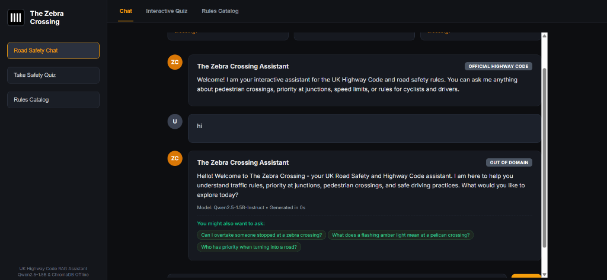
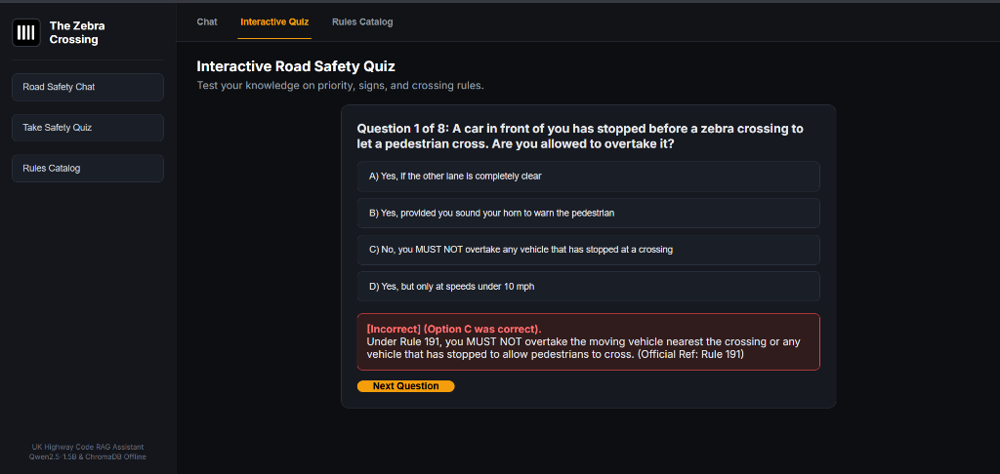
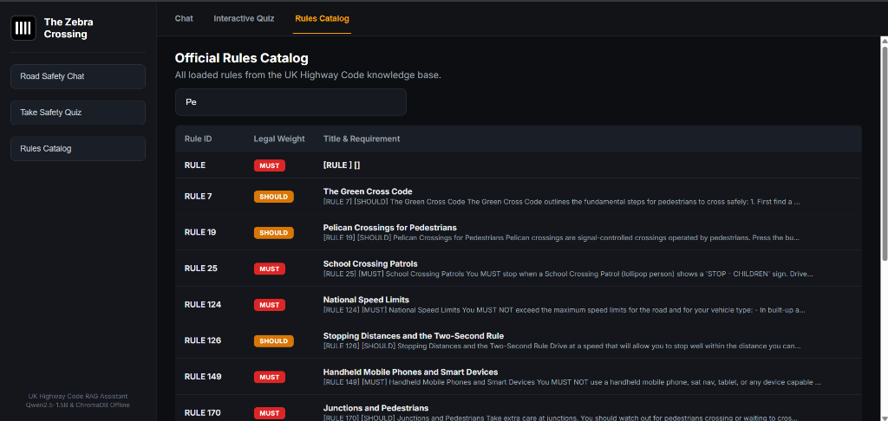

# The Zebra Crossing - Road Safety Assistant

Developer: Enoch Obikoya
Project: Personal Road Safety Assistant Project

---

**About My Project**

My name is Enoch Obikoya, and this is my personal project. I developed The Zebra Crossing to provide a reliable, offline-first road safety assistant for the UK Highway Code. My goal was to create a system that runs entirely on local consumer hardware without sending personal data to external APIs, while strictly preventing artificial hallucinations.

I designed the assistant around a curated knowledge base of 15 essential UK Highway Code rules covering pedestrian crossings, junction priority, national speed limits, parking safety, and vulnerable road users. A key legal principle I embedded into my project is the distinction between mandatory rules (MUST / MUST NOT), which are legally binding statutory offences under the Road Traffic Act, and advisory guidance (SHOULD / SHOULD NOT).

---

**System Architecture**

I designed my project using a multi-stage local retrieval-augmented generation (RAG) architecture:

1. User Interface Layer
I provide three distinct ways to interact with my assistant:
* Interactive Console Mode: A terminal interface with rich formatting for questions, quizzes, and scenario coaching.
* Lightweight Web Interface: A zero-dependency web server built directly on Python's http.server running at port 7860.
* Streamlit Dashboard: A multi-tab dashboard offering interactive chat, rule browsing, and knowledge assessments.

2. Fast Conversational Router
Before querying the retrieval pipeline, my assistant passes user input through a compiled regex matcher loaded from my interactive prompts dataset. If a user offers a greeting, farewell, or expression of thanks, my system returns an instant conversational response in under 5 milliseconds without invoking heavy neural models.

3. Hybrid Retrieval Pipeline
For road safety questions, I built a hybrid retrieval engine combining two complementary search methods:
* Dense Vector Search: I use sentence-transformers/all-MiniLM-L6-v2 to encode questions and Highway Code rules into 384-dimensional vector embeddings, persisted locally in ChromaDB. This captures semantic concepts and intent even when the user does not use exact legal terminology.
* Sparse Lexical Search: I implemented a custom BM25 keyword ranking algorithm that scores documents using term frequency and inverse document frequency (IDF). This ensures exact technical terms like "Dutch Reach", "Rule 195", or "pelican crossing" receive high relevance scores.
* Reciprocal Rank Fusion (RRF): My retriever combines the dense vector distances and BM25 scores into a unified ranking to return the top 3 most relevant rules.

4. Domain Guardrail & Out-of-Domain Refusal
I implemented a cosine distance threshold of 0.52 on the top vector match. If a user asks a question unrelated to UK traffic rules (such as general knowledge, cooking recipes, or sports), the cosine distance exceeds 0.52. In this event, my system immediately halts the pipeline and returns a transparent refusal, stating that it is strictly designed for UK road safety questions.

5. Local LLM Reasoning & Legal Weighting
When valid rules are retrieved, my assistant feeds the question and exact rule context into a locally hosted Qwen2.5-1.5B-Instruct language model running via HuggingFace Transformers. I instruct the model to reason strictly from the retrieved text. My coordinator then validates whether the rule is mandatory (MUST) or advisory (SHOULD) and displays the corresponding legal badge.

6. Citation Verification Guardrail
To ensure factual accuracy, my post-processing logic extracts every rule number cited by the model and checks it against my 15 ground-truth rules in the database. If the model attempts to invent an unverified rule number, my assistant automatically substitutes the verified ground-truth text from the retrieved rule.

---

**Features I Built**

* Grounded Answers: Every response is directly cited against the 15 official Highway Code rules in my database.
* Legal Distinctions: Clearly marks whether an action is required by law (MUST) or advised as safe practice (SHOULD).
* Out-of-Domain Rejection: Safely declines to answer irrelevant queries outside UK road safety.
* Interactive 8-Question Quiz: An interactive Highway Code quiz with instant feedback, scoring, and performance badges.
* Hazard Perception Scenarios: Real-world driving situations requiring the user to choose the safest defensive driving decision.
* Rule Catalog & Keyword Search: Browse rules by topic or search directly by rule number and keywords.
* Session History: Tracks all questions and responses within a session with clear history support.

---

**Application Screenshots**

Here are screenshots of my assistant running locally across its three primary interface views:

* Road Safety Chat Interface:

* Interactive Road Safety Quiz:

* Highway Code Rules Catalog:

---

**Getting Started**

1. Install requirements:

pip install -r requirements.txt

2. Run my interactive terminal assistant:

python main.py

---

**Console Commands**

When running my interactive terminal assistant, you can type your question directly or use any of these commands:

* quiz : Start the 8-question Highway Code quiz.
* scenario : Practice real-world road safety scenarios.
* browse : Browse my loaded Highway Code rules by category.
* search <term> : Search the rules database for a specific keyword.
* rule <number> : Look up a specific rule (e.g. rule 195).
* history : View the questions asked during your session.
* web : Start the local web UI in your browser.
* help : Display available commands.
* exit or q : Quit the program.

---

**Command Line Options**

* python main.py : Starts the standard interactive terminal session.
* python main.py --quiz : Starts the quiz directly.
* python main.py --scenario : Starts the scenario practice directly.
* python main.py --web : Launches my zero-dependency browser interface at http://127.0.0.1:7860.
* python main.py --gui : Launches my Streamlit dashboard at http://localhost:8501.
* python main.py --question "Is it permitted to overtake a car waiting at a zebra crossing?" : Answers a single query and exits.

---

**Project Files**

* app.py : Streamlit dashboard interface.
* assistant.py : Core coordinator managing retrieval, prompt matches, and legal weighting.
* data/rules.txt : My curated dataset of 15 UK Highway Code rules.
* data/interactive_prompts.csv : Conversational triggers for greetings, farewells, and help.
* interactive.py : Terminal CLI presenter, quiz engine, and hazard perception scenarios.
* main.py : Application entry point and command-line argument parser.
* main_phase1.py : Standalone runner for testing in standard Python environments.
* models.py : Local model loader for Qwen2.5-1.5B with rule citation checks.
* rag.py : Knowledge retrieval pipeline combining ChromaDB MiniLM embeddings with BM25.
* web_ui.py : Lightweight web server using Python's built-in http.server.
